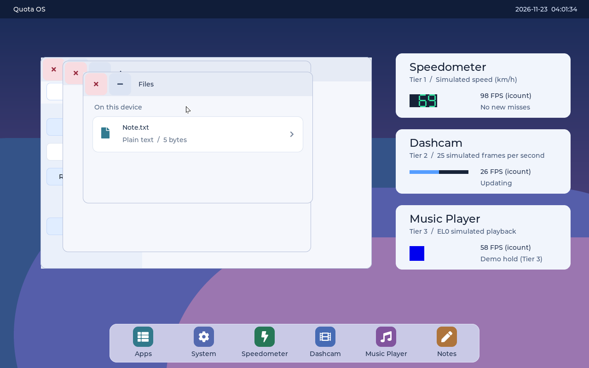

# Quota OS — WebKit port

Run `bash tools/run-webkit.sh` with QEMU ARM64 installed. This branch brings up upstream JavaScriptCore and a WebCore CSS parser on Quota OS. The current test evaluates two scripts, parses a CSS hex color, fills the guest framebuffer and returns to the kernel. The QEMU window shows a solid red 640 × 480 frame. HTML layout and interactive browser windows are still pending.

运行 `bash tools/run-webkit.sh` 可验证 JavaScriptCore 和 WebCore 的颜色解析。当前显示的是 640 × 480 的红色测试画面，HTML 排版和可交互的浏览器窗口尚待移植。

[Serial log](docs/tests/webkit-stack/guest.log) · [Actual QEMU output](docs/tests/webkit-stack/frame.png) · [LVGL desktop branch](https://github.com/leiquan/Quota-OS/tree/Desktop-LVGL-120X800)

## LVGL desktop baseline


Quota OS is an experimental single-core ARM64 operating system built around resource quotas. Its 1280 × 800 LVGL desktop runs on QEMU. A speedometer uses a fixed Tier 1 CPU slot, a dashcam demo requests a Tier 2 reservation, and music and desktop interaction share the Tier 3 pool. CPU deadlines are measured against the guest clock. The demos use simulated speed, video frames and playback activity.

Quota OS 是一个以资源配额为核心的单核 ARM64 实验操作系统。一级由厂商预留固定时间槽，二级由应用申报、用户选择启用，三级共享剩余资源。桌面提供任务监控、现场测试和持久笔记。当前验收基于 QEMU 虚拟时钟及帧缓冲提交，物理显示和实际 SSD 的最坏时延尚待验证。

## Tasks and application control

System groups scheduler tasks by tier. Each row shows CPU use in the sampled 10 ms period and the applicable reservation, grant or shared pool. Right-click or long-press a demo task to inspect its controls. The kernel protects Tier 1 tasks. Stopping the dashcam or music player releases its reservations, and restarting it goes through admission again.


## System information

Fixed label and value columns keep changing counters aligned. CPU values cover the last completed period. The memory percentage measures reserved capacity. The event counters include Tier 2 budget overruns and Tier 3 pool crossings.


## Live system checks

Open **System → Test → Run system checks**. The guest attempts to stop the protected speedometer, observes deadline and budget counters for at least 100 periods, and reads the saved note from disk to verify its contents. The disk check is skipped when no saved note is available. Scheduler stress can be run separately.

The capture below records a genuine failure. The Tier 2 minimum was met, but CPU accounting recorded 107 overrun events during the 107-period observation. Tier 1 recorded zero misses and the Tier 3 pool recorded zero crossings. Strict Tier 2 enforcement remains open.


## Files

Open **Apps → Files** to browse the dedicated note volume. Each file row displays the name, type and byte count. Selecting the row opens the document in Notes. This first version supports one UTF-8 document of up to 495 bytes.



## Persistent notes

Choose **Save** in Notes and wait for **Saved** before shutting down. Two alternating disk records protect the previous version during an update. The guest reports success after the block device acknowledges the flush. Starting with the same disk restores the saved file.


## Run

With QEMU for ARM64 installed, run this command from the repository root.

```sh
bash tools/run-files.sh
```

The launcher uses the prebuilt kernel and creates a dedicated image at `~/.local/share/quota-os/notes.raw` by default. Set `QUOTA_NOTES_DISK` to choose another dedicated image. The status bar displays Shanghai local time.

## Verification

On this build, 100 lifecycle cold boots and 100 desktop-stall cold boots passed under QEMU TCG with `-icount shift=4,sleep=off`. The two ordinary application modes passed 10 cold boots each. In the separate 128 B/s disk test, two sustained saves took 14.315 s and 13.211 s of guest time. The speedometer committed 1,431 and 1,321 frames respectively, with zero deadline misses. A fresh guest reopened the note through Files and the test compared the bytes. [First boot](docs/tests/optimization/live-checks/save.log) · [Second boot](docs/tests/optimization/live-checks/reopen.log) · [Live checks](docs/tests/optimization/live-checks/ui.log) · [Regression logs](docs/tests/optimization/live-checks/regressions.tar.gz)

The LVGL desktop is the working implementation on `main` and `Desktop-LVGL-120X800`. The `Desktop-Webkit-120X800` branch starts from the same revision for WebKit desktop development. Earlier design notes, build instructions and historical experiments are in the [technical notes](TECHNICAL-NOTES.md). [Apache 2.0 license](LICENSE)
