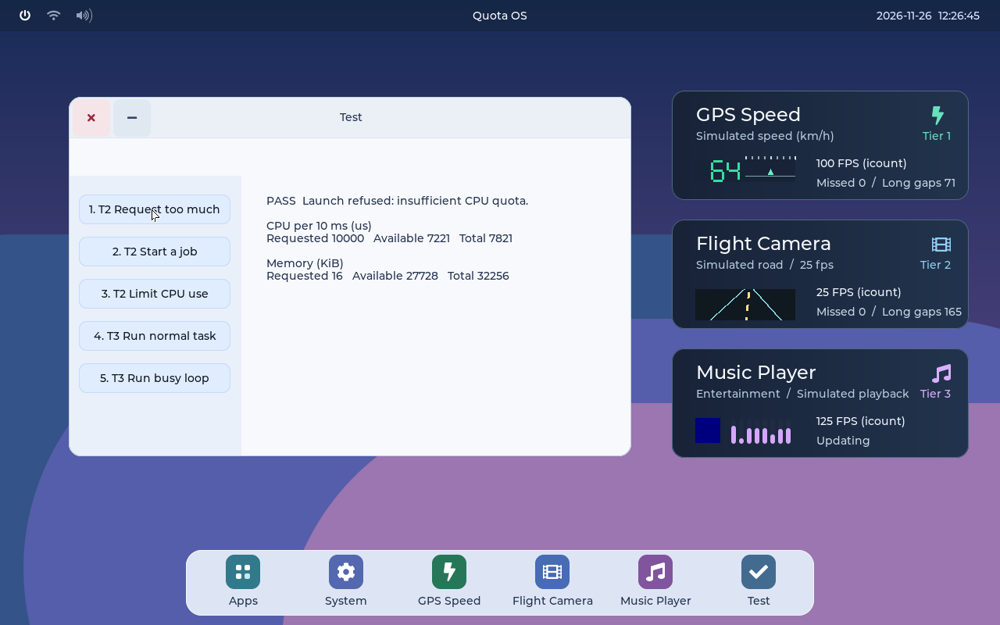
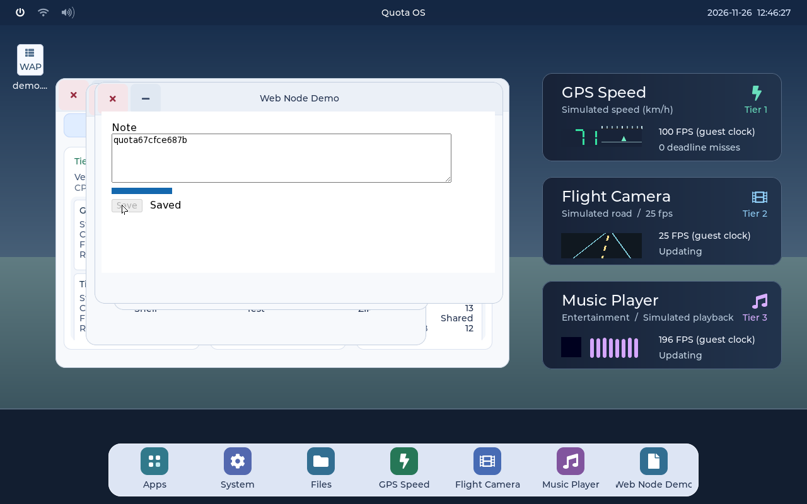
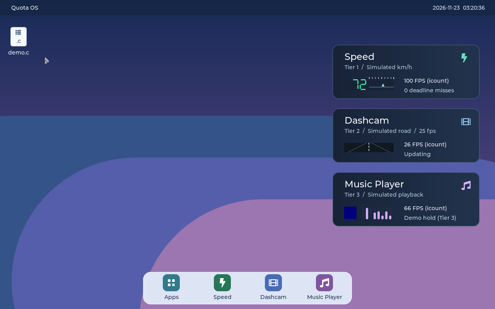
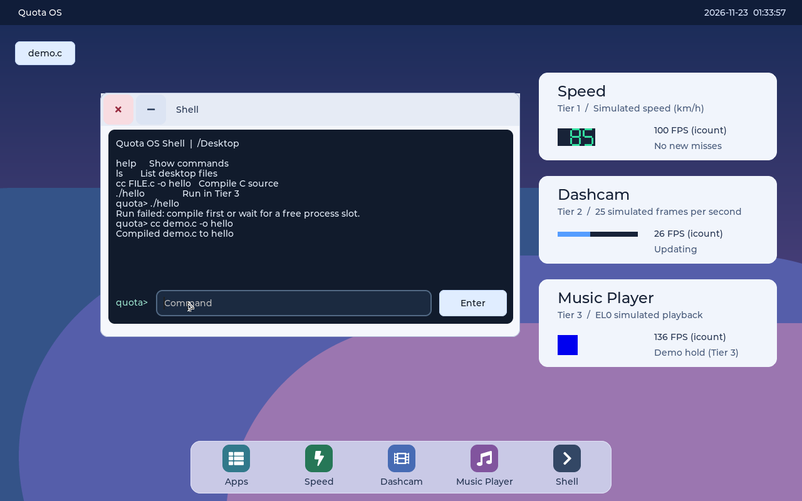

# Quota OS · Web UI 版

**Quick links** · [Run Web UI](#启动本地-web-ui-构建) · [Three editions](#quota-os-editions--三个发行版) · [Documentation and evidence](docs/README.md) · [Official website](https://www.quotaos.org/)

C UI 版（`C-UI`）提供 C 应用和 LVGL 桌面。Web UI 版（`Web-UI`）在同一桌面上增加三级 WAP 应用，由 Blink 渲染页面、Node.js 运行后台。两版共用分级配额内核，串口提供命令行入口。

从 Files 双击 `demo.wap`，Blink 在普通桌面窗口中渲染 HTML/CSS 并执行页面 JS，Node 后台通过本地消息处理保存请求。两个来宾进程加载同一份系统 V8。示例只包含 [app.json](examples/demo/app.json)、[app.html](examples/demo/app.html) 和 [app.js](examples/demo/app.js)。

| 代码位置 | 职责 |
|---|---|
| `kernel/`、`boot/` | 配额、调度、内存保护、进程、设备和文件服务 |
| `port/desktop/` | LVGL 桌面、Files、窗口与输入 |
| `port/wap/` | 应用包启动、窗口恢复、前后台共享的 RPC |
| `port/blink/`、`port/node/` | 页面绘制、输入以及 Node 文件描述符上的消息传输 |

ARM64 运行时的联合构建入口是 [build-node-web-runtime.py](tools/build-node-web-runtime.py)，输入为准备好的 Chromium 142 源码、已应用兼容补丁的 Node 22.21.1 源码和目标 sysroot。镜像构建入口是 [build-lvgl-guest.sh](tools/build-lvgl-guest.sh)。配置 `QUOTA_NODE_WEB_OUT` 后，构建器从联合输出收集两个可执行文件、共享库和运行数据。[扩展运行时构建配置](tools/wap-runtime.sh)

## Quota OS editions · 三个发行版

CLI, C UI and Web UI share the ARM64 quota kernel. CLI provides the serial console and supports a separately launched EL0 Test application. C UI adds the native LVGL desktop. Web UI extends that desktop with Tier 3 WAP applications powered by Blink, V8 and Node.js.

三个版本共用 ARM64 配额内核。CLI 提供串口命令行，Test 作为独立 EL0 应用按需运行。C UI 增加 LVGL 原生桌面，Web UI 在桌面上增加三级 WAP 运行时。

| Edition · 发行版 | Default QEMU RAM · 默认内存 | ARM64 boot image · 启动镜像 |
|---|---|---|
| [CLI](https://github.com/leiquan/Quota-OS/tree/CLI) | 4 MiB | 72.3 KiB |
| [C UI](https://github.com/leiquan/Quota-OS/tree/C-UI) | 64 MiB | 685.4 KiB |
| [Web UI](https://github.com/leiquan/Quota-OS/tree/Web-UI) | 1 GiB | 357.5 MiB |

The two desktop figures are verified QEMU launch configurations. CLI passed serial interaction and the standalone EL0 Test in both quota modes at 3 MiB in a short QEMU run. Graphical builds include their respective UI and runtime components.

图形版内存值是已验证的 QEMU 启动配置。CLI 在 3 MiB 下通过串口交互和独立 EL0 Test 的二三级短程验证。Web UI 镜像包含共享运行时、动态库、字体和启动数据，示例 `demo.wap` 为 **1,705 字节**。

[Web UI app structure and validation · Web UI 应用结构与验收](docs/README.md#web-ui-development--web-ui-开发)

### 开发与验证

- **CLI**：在串口运行基础命令，用 C 编译独立 EL0 Test，并在默认 4 MiB 下验证二三级运行与磁盘读回。[启动指南](https://github.com/leiquan/Quota-OS/tree/CLI) · [验收日志](docs/tests/cli-4m/)
- **C UI**：在 `kernel/` 开发内核与驱动，在 `port/desktop/` 用 C 和 LVGL 实现界面。用 ARM64 工具链执行 `bash tools/build-lvgl-guest.sh`，再用 `QUOTA_KERNEL=build/quotaos-lvgl.bin bash tools/run-files.sh` 启动新镜像。在 Apps → Test 检查准入、CPU 配额和仪表提交。
- **Web UI 系统**：在准备好的 Chromium 142 与 Node 22.21.1 源码上应用分支内的兼容补丁，用 `tools/build-node-web-runtime.py` 联合构建 Blink 和 Node，使二者依赖相同的 `libv8.so`。将 `QUOTA_NODE_WEB_OUT` 指向联合输出，并指定 ARM64 动态加载器、库目录和字体，再执行 `bash tools/build-lvgl-guest.sh`。产物是 `build/quotaos-node-web.bin`。[构建入口](https://github.com/leiquan/Quota-OS/blob/Web-UI/tools/build-node-web-runtime.py) · [镜像配置](https://github.com/leiquan/Quota-OS/blob/Web-UI/tools/wap-runtime.sh)
- **Web UI 应用**：将 `app.json`、`app.html` 和可选的后台 `app.js` 放在 ZIP 根目录，使用存储模式，扩展名为 `.wap`。系统内的 ZIP App 可以导出 Web Node Demo。在 Files 双击后，页面通过 `rpc.get('save', text)` 调用三级 Node 后台写盘。关闭 QEMU 后保留数据盘，再次启动、打开 Web Node Demo 即可检查原文。[应用源码](https://github.com/leiquan/Quota-OS/tree/Web-UI/examples/demo)

页面与后台均可用 `await rpc.set(name, handler)` 注册方法，用 `await rpc.get(name, ...args)` 调用对端并接收返回值。每个运行中的 WAP 实例有一张方法名表。注册成功后方法名归注册端所有，直到该实例结束。同端重复、跨端重名以及注册 `set`、`get` 都会拒绝 Promise。并发争用同一名称只有一次注册成功。参数和返回值用 JSON 表示，每个消息最多 1024 个 UTF-8 字节。





### 启动本地 Web UI 构建

在仓库根目录运行。以下命令首次创建专用的 64 KiB 应用数据盘，再次执行会复用这块盘。

```sh
test -e build/wap-data.raw || (set -C; umask 077; dd if=/dev/zero bs=1024 count=64 >build/wap-data.raw)
qemu-system-aarch64 -machine virt,gic-version=2 -cpu cortex-a35 -m 1G -nic none \
  -global virtio-mmio.force-legacy=false -device virtio-rng-device -device ramfb \
  -device virtio-tablet-device -device virtio-keyboard-device \
  -drive if=none,id=notes,format=raw,file=build/wap-data.raw \
  -device virtio-blk-device,drive=notes,serial=QUOTA-NOTES -icount shift=1,sleep=off \
  -kernel build/quotaos-node-web.bin -append apps-video -serial stdio -monitor none
```

## LVGL desktop baseline


Quota OS is an experimental single-core ARM64 operating system built around resource quotas. Its 1280 × 800 LVGL desktop runs on QEMU with one Cortex-A35 core and 64 MiB of RAM by default. A speedometer uses a fixed Tier 1 CPU slot, a dashcam demo requests a Tier 2 reservation, and music and desktop interaction share the Tier 3 pool. CPU deadlines are measured against the guest clock. The demos use simulated speed, video frames and playback activity.

Quota OS 是一个以资源配额为核心的单核 ARM64 实验操作系统。一级由厂商预留固定时间槽，二级由应用申报、用户选择启用，三级共享剩余资源。桌面提供任务监控、现场测试和持久笔记，默认以 QEMU 单核 Cortex-A35 和 64 MiB 内存运行。当前验收基于 QEMU 虚拟时钟及帧缓冲提交，物理显示和实际 SSD 的最坏时延尚待验证。

## Run the prebuilt LVGL desktop

[Download the desktop preview](https://github.com/leiquan/Quota-OS/releases/latest) for the standalone ARM64 image and launch commands. If you prefer a local checkout, use the launcher below.

Install Git and QEMU with ARM system emulation (macOS: `brew install git qemu`; Ubuntu/Debian: `sudo apt install git qemu-system-arm qemu-system-gui`). From a graphical desktop, run:

```sh
git clone --branch C-UI https://github.com/leiquan/Quota-OS.git
cd Quota-OS
bash tools/run-files.sh
```

The launcher boots the included ARM64 image and creates a persistent Notes disk on first use. No cross-compiler is required.

## Vehicle instruments

GPS Speed updates its digital readout and linear pointer from the reserved Tier 1 display path. Its deadline counter is cumulative. Flight Camera animates simulated lane markings at a target of 25 frames per second in Tier 2, updating only changing pixels after initialization. The GPS Speed, Flight Camera and Music Player cards display their tier at the right. Music Player shows eight recent samples of frame delivery in the shared Tier 3 pool. GPS Speed and Flight Camera FPS use timestamps from completed framebuffer commits. The Test app also reports their longest observed gaps; the intentional camera pause starts a new interval on resume. The labels and history are sampled by the desktop; GPS Speed continues to commit while that desktop is stalled.



[Watch the QEMU capture](docs/screenshots/instruments-live.gif) · [Run the measured LVGL build](https://github.com/leiquan/Quota-OS/tree/7e594c7)

[100 desktop-stall cold boots with these instruments](docs/tests/cortex-a35/instrument-regression.tar.gz)

The LVGL frontend lives in `port/desktop/`. Hardware access belongs to `kernel/drivers/`; the scheduler and admission code stay in `kernel/`. The serial and graphical builds read the same core source list from `kernel/sources.list`.

## Tasks and application control

System groups scheduler tasks by tier. Each row shows CPU use in the sampled 10 ms period and the applicable reservation, grant or shared pool. Right-click or long-press a demo task to inspect its controls. The kernel protects Tier 1 tasks. Stopping the dashcam or music player releases its reservations, and restarting it goes through admission again.


## System information

System Info shows the boot peaks for total busy time, kernel time, and Tier 1 job start lateness. It also shows the kernel reserve target, the funded reserve, warning and overrun periods, and CPU returned by completed Tier 2 jobs. CPU values cover the last completed period. The memory percentage measures reserved capacity. The event counters include Tier 2 budget overruns and Tier 3 pool crossings.


## CPU admission and overload

Each 10 ms period starts with four fixed Tier 1 slots totalling 1,500 µs and 80 µs of slot guards. The kernel reserve starts at 350 µs. After a new per-period kernel accounting record, the target grows to 120% of that record rounded up to a whole microsecond. It persists for this boot. At replenishment, growth draws from the Tier 3 pool and respects existing Tier 2 minimum grants. If the pool reaches zero before the target is funded, new positive CPU reservations wait for capacity and their launch requests are refused. System Info displays the gap. [Admission boundary test](docs/tests/adaptive-reserve/boundary.txt)

At a scheduling decision after recorded kernel use reaches 80% of the funded reserve, the scheduler suspends new Tier 3 dispatches for the rest of that period. Tier 1 slots and admitted Tier 2 work retain precedence. A Tier 2 periodic job completing early can return the unused part of its funded minimum for this period when the kernel target is funded. Pending I/O and a voluntary yield from an ordinary thread do not release reserved capacity. The observed peak includes guard handling. Adaptive sizing takes effect in subsequent periods and supplies an empirical margin for these workloads.

In the desktop-stall run the boot peak was 8,354 µs busy per period (83.54%). The kernel peaked at 422 µs as displayed, and the funded reserve reached 507 µs. Tier 1 start lateness rounded up to 1 µs. The last sampled period returned 504 µs to Tier 3. The 100-period window recorded 100 speedometer commits, 25 dashcam commits, zero missed speedometer deadlines and zero pool crossings. The previous image produced the same commit counts and maximum gap of 10,013 µs. These measurements establish isolation in this scenario. An optimal-throughput claim would require comparable useful work per period across workloads. [Before](docs/tests/adaptive-reserve/baseline.log) · [After](docs/tests/adaptive-reserve/stall.log)

The desktop uses QEMU ramfb and measures guest framebuffer commits. A boot with virtio-gpu alone reached the kernel but failed framebuffer initialization. GPU queue timing, host presentation and physical scanout remain unverified. [Virtual GPU probe](docs/tests/adaptive-reserve/virtio-gpu.log)

## Compare / 系统对比

### English

Quota OS explores resource isolation for automotive instruments and eVTOL displays. Critical display work has a fixed CPU slot, admitted applications receive a minimum, and ordinary workloads share a capped pool.

| System | Resource mechanism | Quota OS comparison |
| --- | --- | --- |
| QNX | Adaptive partitions allocate minimum CPU shares to groups of threads and share spare capacity. | Quota OS gives applications three explicit admission policies and caps the aggregate best-effort pool. [Official docs](https://www.qnx.com/developers/docs/7.1/) |
| seL4 MCS | Scheduling contexts carry a budget and period and can transfer execution budget across IPC. | System integrators define policy with those primitives. Quota OS defines the tier and admission policy in the OS. [Official docs](https://docs.sel4.systems/Tutorials/mcs.html) |
| Linux | SCHED_DEADLINE provides runtime, deadline and period parameters, admission control and optional bandwidth reclaiming. | An integrator can combine Linux controls to build similar isolation. Quota OS exposes the three-tier policy directly. [Official docs](https://docs.kernel.org/scheduler/sched-deadline.html) |
| VxWorks 653 | ARINC 653-style time and space partitioning separates workloads into configured partitions. | Fixed partition timing is closest to Tier 1. Quota OS also demonstrates user-approved reservations and an aggregate shared pool. [Official docs](https://www.windriver.com/products/vxworks) |

The published QEMU icount tests cover CPU scheduling and guest framebuffer commits. Comparative real-hardware latency, aircraft flight control, and safety certification remain outside the verified scope.

### 中文

Quota OS 是面向车载仪表和 eVTOL 显示场景的资源隔离原型。关键显示使用固定 CPU 槽，准入应用获得最低配额，普通工作负载共享有上限的总池。

| 系统 | 资源机制 | 与 Quota OS 对比 |
| --- | --- | --- |
| QNX | 自适应分区为一组线程设置最低 CPU 份额，并共享空闲时间。 | Quota OS 为应用定义三种准入方式，并限制三级共享池总量。 [官方资料](https://www.qnx.com/developers/docs/7.1/) |
| seL4 MCS | 调度上下文携带预算与周期，可以通过 IPC 转移执行预算。 | 系统集成方用这些机制制定策略。Quota OS 在系统中直接定义级别与准入规则。 [官方资料](https://docs.sel4.systems/Tutorials/mcs.html) |
| Linux | SCHED_DEADLINE 提供运行预算、截止期、周期、准入控制和可选的带宽回收。 | Linux 可以组合出类似隔离策略。Quota OS 直接把三级规则呈现在应用准入和运行中。 [官方资料](https://docs.kernel.org/scheduler/sched-deadline.html) |
| VxWorks 653 | ARINC 653 式时间和空间分区将工作负载放入预先配置的分区。 | 固定分区的时序接近一级。Quota OS 同时演示用户批准的二级配额和有总上限的三级池。 [官方资料](https://www.windriver.com/products/vxworks) |

已发布的 QEMU icount 测试覆盖 CPU 调度和来宾帧缓冲提交。真实硬件横向时延、飞行控制和安全认证均尚未验证。

## Live system checks

Open **Test** from **Apps** on the vehicle desktop. **System** shows tasks, system information and the last eight observed quota or deadline event groups. Select one workload at a time. The two admissible Tier 2 workloads require **Allow launch**. Cancel dismisses the request before it reserves resources.

| Scenario | What the guest checks |
| --- | --- |
| 1. T2 Request too much | Request 10,000 µs of CPU per 10 ms period. Admission must refuse the launch. The result shows requested, currently available and total application CPU and memory. |
| 2. T2 Start a job | Reserve 400 µs per period and 16 KiB. Verify the periodic job runs and meets its deadline. |
| 3. T2 Limit CPU use | Run a CPU-bound task with a 400 µs minimum and an 800 µs ceiling per period. Check shortfalls, overruns and measured peak use. |
| 4. T3 Run normal task | Launch an EL0 process that yields voluntarily. Verify it receives CPU time. |
| 5. T3 Run busy loop | Launch an EL0 process that never yields. Observe speedometer commits, deadline misses and shared-pool crossings while it runs. |

The Tier 3 busy loop runs for at least 1,000 guest periods (10 seconds of guest time). Other runnable workloads run for at least 100 periods. Each result includes actual Music Player commits. During contention, the player continues to submit as CPU time becomes available. The scenario PASS reports the checks listed above and the tier counters. Check the peak gaps separately against the 10 ms GPS Speed and 40 ms Flight Camera targets. The reported gaps are boot-to-date maxima, so they cannot attribute a long gap to the current scenario alone.


## Files

Apps stays first in the Dock. Open windows and running vehicle apps occupy the other slots. Minimized windows keep their icon and dot. When all other apps close, up to five recent apps from this desktop session appear in most-recently-used order.

Open **Apps → Files** to browse the same files shown on the desktop. Each file row displays the name, type and byte count. Selecting the row opens the document in Notes. The desktop can hold one plain-text note (up to 495 bytes) and one C source file (up to 463 bytes).


## Persistent notes

Choose **Save** in Notes and wait for **Saved** before shutting down. Two alternating disk records protect the previous version during an update. The guest reports success after the block device acknowledges the flush. Starting with the same disk restores the saved file.


## Notes disk configuration

With QEMU for ARM64 installed, run this command from the repository root.

```sh
bash tools/run-files.sh
```

The launcher uses the prebuilt kernel and creates a dedicated image at `~/.local/share/quota-os/notes.raw` by default. Set `QUOTA_NOTES_DISK` to choose another dedicated image. The status bar displays Shanghai local time.

## Develop a C application in Quota OS

Start with the Notes disk attached using `bash tools/run-files.sh`. In Notes, choose **C Example** to insert the program below, or type it yourself. Choose **Save As...**, enter `demo.c`, and press Enter. The saved source appears on the desktop and in Files.

```c
int main(void) {
    puts("Hello, Quota OS!");
    return 0;
}
```

Open **Apps → Shell**. Type each command at the `quota>` prompt and press **Enter**. The terminal retains a scrollable record of commands and results. Type `cc` alone for an example using the saved filename.

```sh
cc demo.c -o hello
./hello
```

The compiler emits ARM64 instructions inside Quota OS. The program runs in Tier 3 EL0 and writes `Hello, Quota OS!` to Shell. This first release accepts the small C subset shown above. It supports one saved source file, at most 463 bytes, alongside the existing note. The compiled binary stays in memory until reboot. Tier 2 admission from Shell and a general C compiler remain future work. Tier 1 is vendor reserved. [First boot](docs/tests/c-workflow/qemu.log) · [Cold reboot](docs/tests/c-workflow/source-reopen.log)

| Source saved in Notes | Compilation in Shell | Output from EL0 |
| --- | --- | --- |
|  |  |  |

## Verification

The default single-core Cortex-A35 / 64 MiB image passed 100 QEMU `icount` cold boots with the Tier 3 desktop in a busy loop. In every 100-period sample, the guest recorded 100 speedometer commits and 25 dashcam commits, with zero speedometer deadline misses and zero Tier 3 pool crossings. The maximum speedometer commit gap was 10,013 microseconds in each run. This measures guest framebuffer commits. Host presentation and physical scanout remain unverified. [All 100 serial logs and results](docs/tests/cortex-a35/frame-regression.tar.gz)

The default Cortex-A35 / 64 MiB guest passed three desktop-stall boots and three ordinary boots in each demo mode. The five System Test scenarios passed through tablet input. Notes saved on the throttled disk and reopened through Files after a cold boot. In the third desktop-stall run, the speedometer committed 100 frames and the dashcam committed 25 over 100 periods, with zero speedometer deadline misses and zero Tier 3 pool crossings. The QEMU CPU model and RAM changed while the virtual instruction budget remained at `icount shift=4`. [Desktop stall](docs/tests/cortex-a35/03-apps-desktop-stall.log) · [System tests](docs/tests/cortex-a35/ui.log) · [Files](docs/tests/cortex-a35/files.log)

The earlier Cortex-A72 / 128 MiB release passed 100 desktop-stall boots, 100 lifecycle boots, and 10 boots each with and without the dashcam. The tablet-input replay verified all five scenarios and cancellation before approval. With disk writes limited to 128 B/s, the two measured saves took 16.321 and 16.083 seconds of guest time. The speedometer recorded zero deadline misses and Files reopened the saved note after a cold boot. [Cold boot logs](docs/tests/adaptive-reserve/cold-boots.tar.gz) · [Approval replay](docs/tests/adaptive-reserve/ui.log) · [Save](docs/tests/adaptive-reserve/save.log) · [Reopen](docs/tests/adaptive-reserve/reopen.log)

In the earlier live-checks regression, 100 lifecycle cold boots and 100 desktop-stall cold boots passed under QEMU TCG with `-icount shift=4,sleep=off`. The two ordinary application modes passed 10 cold boots each. In the separate 128 B/s disk test, two sustained saves took 14.315 s and 13.211 s of guest time. The speedometer committed 1,431 and 1,321 frames respectively, with zero deadline misses. A fresh guest reopened the note through Files and the test compared the bytes. [First boot](docs/tests/optimization/live-checks/save.log) · [Second boot](docs/tests/optimization/live-checks/reopen.log) · [Live checks](docs/tests/optimization/live-checks/ui.log) · [Regression logs](docs/tests/optimization/live-checks/regressions.tar.gz)

The C UI branch builds the LVGL desktop. The Web UI branch adds Blink, V8 and Node.js for Tier 3 WAP applications. Earlier design notes, build instructions and historical experiments are in the [technical notes](TECHNICAL-NOTES.md). [Apache 2.0 license](LICENSE)

## Historical WebKit prototypes

Run `bash tools/run-webkit.sh` with QEMU ARM64 installed. This branch brings up upstream JavaScriptCore and a WebCore CSS parser on Quota OS. The current test evaluates two scripts, parses a CSS hex color, fills the guest framebuffer and returns to the kernel. The QEMU window shows a solid red 640 × 480 frame. HTML layout and interactive browser windows are still pending.

运行 `bash tools/run-webkit.sh` 可验证 JavaScriptCore 和 WebCore 的颜色解析。当前显示的是 640 × 480 的红色测试画面，HTML 排版和可交互的浏览器窗口尚待移植。

[Serial log](docs/tests/webkit-stack/guest.log) · [Actual QEMU output](docs/tests/webkit-stack/frame.png) · [LVGL desktop branch](https://github.com/leiquan/Quota-OS/tree/C-UI)

### Preview a local HTML page

On macOS with QEMU and the Xcode command-line tools installed, run:

```sh
bash tools/run-webkit.sh --page docs/archive/webkit/hello.html
```


Change the heading in the file and launch again to see the new text. This is a static preview of self-contained UTF-8 HTML (1–16,384 bytes). macOS WKWebView lays out the document with inline CSS and system fonts, with page JavaScript disabled. The launcher supplies the same HTML and its rendered 1280 × 800 XRGB frame through QEMU fw_cfg; Quota OS displays that frame in ramfb. In-guest WebCore layout, scrolling and interactive browsing remain pending.

在 macOS 上执行上面的命令，就能在 QEMU 中看到文件里的标题和正文。当前采用宿主 WebKit 排版、来宾显示的静态预览。

For the cross-platform transport check use `--page-bytes FILE`; the serial console reports the file length and checksum. Run `python3 tools/webkit-document-check.py` for all five boundary cases. With no argument the launcher boots the separate in-guest JSC and WebCore CSS color test.

公共内核和 LVGL 桌面的改动先提交到 `C-UI`。在 `Web-UI` 合并基础版后，分别验证 64 MiB 桌面配额场景和 1 GiB WAP 保存、冷启动读回。Blink、Node、共享 V8 和 WAP 适配在 `Web-UI` 维护。
