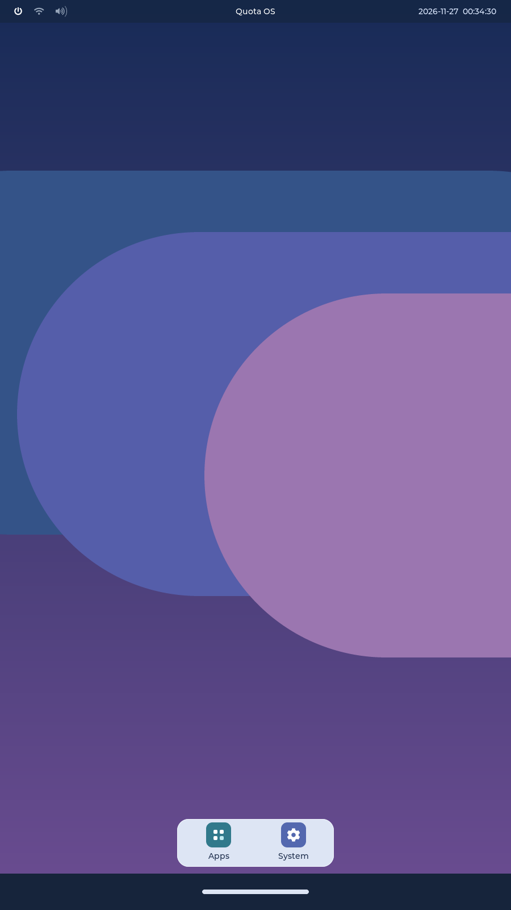
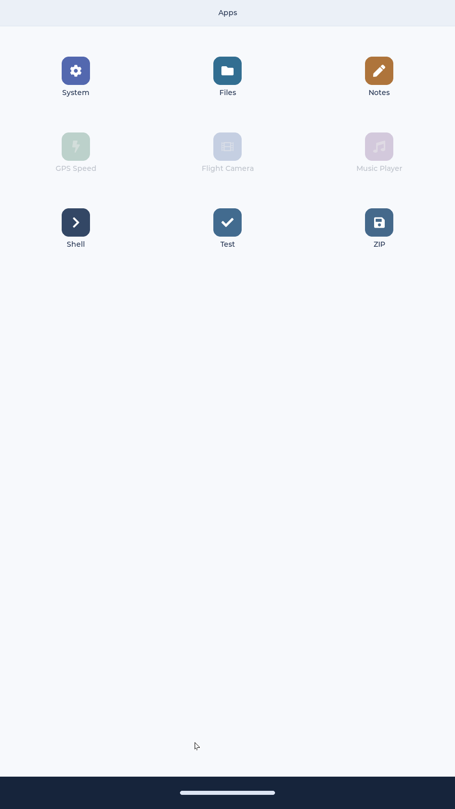
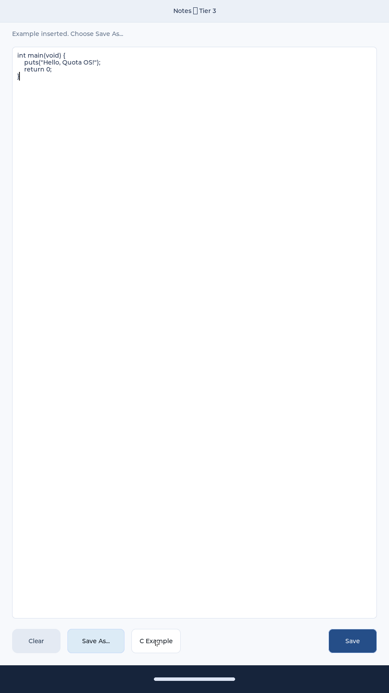
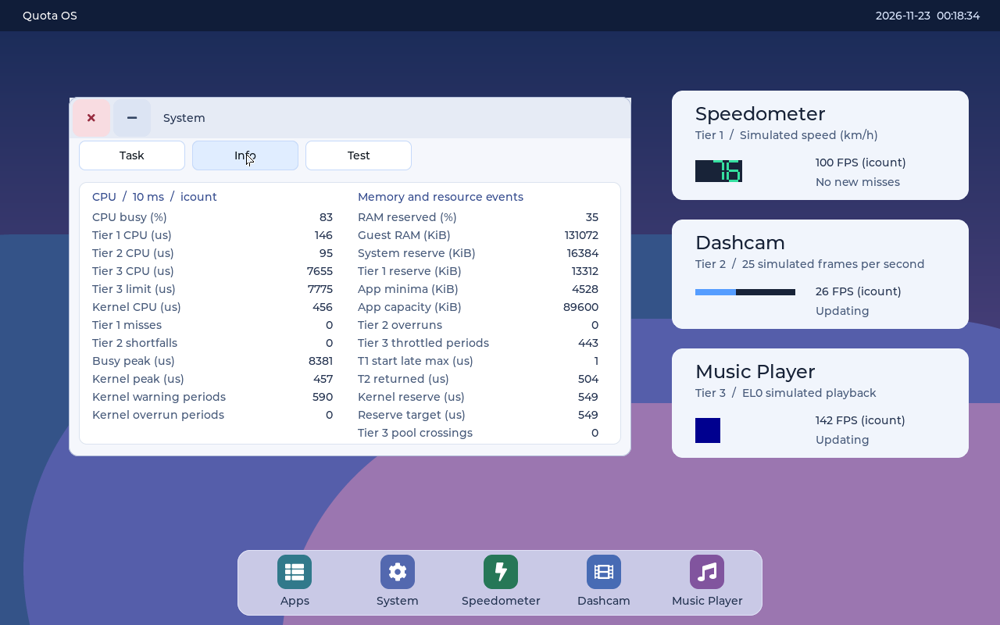
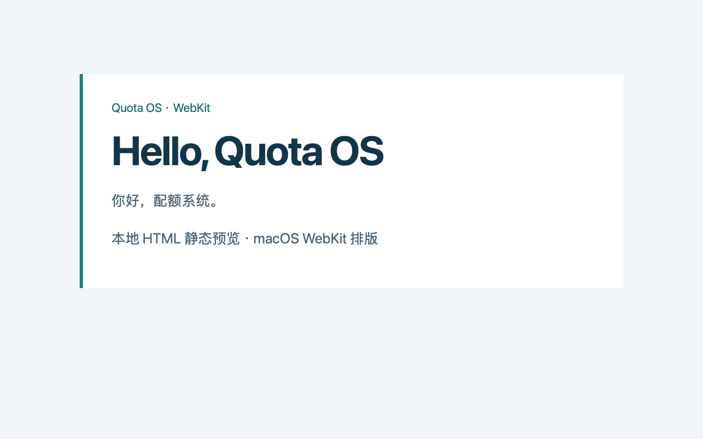

**Official website / 官网** · [English](https://www.quotaos.org/) · [简体中文](https://www.quotaos.org/zh.html)

# Quota OS · Touch UI

Touch UI is the 900 × 1600 portrait edition of Quota OS. Applications open full screen. Use the bottom bar to go back or return to the home screen while keeping the current app state.

Touch UI 是 Quota OS 的 900 × 1600 竖屏版。应用全屏打开，底部 Bar 负责返回和回主屏，切回应用时保留现场。

[Run Touch UI · 启动](#run-touch-ui) · [Technical notes · 技术说明](TECHNICAL-NOTES.md#touch-ui) · [Documentation · 文档导航](docs/README.md)


## Quota OS editions · 四个发行版

CLI, GUI, Web UI and Touch UI share the ARM64 quota kernel. CLI provides the serial console and supports a separately launched EL0 Test application. GUI adds the native LVGL desktop. Web UI extends that desktop with Tier 3 WAP applications powered by Blink, V8 and Node.js. Touch UI provides a 900 × 1600 portrait desktop with full-screen applications and a bottom gesture bar.

四个版本共用 ARM64 配额内核。CLI 提供串口命令行，Test 作为独立 EL0 应用按需运行。GUI 增加 LVGL 原生桌面，Web UI 在桌面上增加三级 WAP 运行时。Touch UI 提供 900 × 1600 竖屏、全屏应用和底部手势栏。
All four editions support command-line executables compiled from C for Quota OS. In CLI, run them from the shell over the serial console. In GUI, Web UI and Touch UI, open Shell from the desktop to run them.

四个发行版均支持运行由 C 代码编译的 Quota OS 命令行可执行文件。在 CLI 版，通过串口进入 Shell 运行程序；在 GUI、Web UI 和 Touch UI 版，从桌面打开 Shell 运行程序。

| Edition · 发行版 | vCPU | Default guest RAM · 默认虚拟机内存 |
|---|---:|---:|
| [CLI](https://github.com/leiquan/Quota-OS/tree/CLI) | 1 | 4 MiB |
| [GUI](https://github.com/leiquan/Quota-OS/tree/GUI) | 2 | 64 MiB |
| [Web UI](https://github.com/leiquan/Quota-OS/tree/Web-UI) | 2 | 512 MiB |
| [Touch UI](https://github.com/leiquan/Quota-OS/tree/Touch-UI) | 2 | 512 MiB |

These defaults also apply on macOS. Web UI loads Blink, V8 and Node.js from a separate read-only runtime volume.

普通启动和 macOS 启动采用相同配置。内存列表示分配给整台虚拟机的容量。

[Web UI app structure and validation · Web UI 应用结构与验收](docs/README.md#web-ui-development--web-ui-开发) · [Todo / 任务清单示例](https://github.com/leiquan/Quota-OS/tree/Web-UI/examples/todo)

## Touch UI screenshots · 触屏版实拍

900 × 1600 QEMU captures · 900 × 1600 QEMU 竖屏实拍

| Home · 主屏 | Apps · 应用列表 | Notes · 全屏便笺 |
|---|---|---|
|  |  |  |

## Run Touch UI

先安装支持 ARM64 系统模拟的 QEMU 和 AArch64 GNU 交叉工具链，再从 Touch UI 源码构建。

```sh
git clone --branch Touch-UI https://github.com/leiquan/Quota-OS.git
cd Quota-OS
bash tools/build-lvgl-guest.sh
QUOTA_KERNEL=build/quotaos-lvgl.bin bash tools/run-files.sh
```

Apple Silicon 可以用 Homebrew 的 `qemu`、`llvm` 和 `lld`。先设置构建所需的工具路径，再通过项目脚本打开大尺寸普通窗口。

```sh
QUOTA_LLVM_BIN="$(brew --prefix llvm)/bin" QUOTA_LLD="$(brew --prefix lld)/bin/ld.lld" bash tools/build-lvgl-guest.sh
bash tools/run-macos-gui.sh build/quotaos-lvgl.bin
```

在 macOS 上通过项目启动脚本打开 Quota OS，Dock 会使用[官网标志](docs/quota-mark.svg)。启动脚本会将标志装入本地 QEMU 应用包。

| 操作 | 结果 |
|---|---|
| 底部 Bar 单击或向上滑一次 | 返回上一页 |
| 底部 Bar 双击或连续向上滑两次 | 回主屏，保留当前应用现场 |
| 移动或按下 QEMU 鼠标 | 圆形指针跟随，按下时变蓝 |

普通和 macOS 启动入口默认使用 2 vCPU、512 MiB，并为 Notes 和 ext4 根目录各建一块盘。默认启动原生 LVGL。已准备 Touch 运行时卷时，可用 `bash tools/run-web-node-volume.sh` 启用来宾 Web 运行时。四版命令、镜像哈希和原始串口日志见[发布验收归档](docs/tests/release-2026-11-27/README.md)。

QEMU 虚拟平板已覆盖四角坐标、单双手势和切回 Notes 后草稿及对话框的恢复。多触点事件解析、实体触摸屏驱动、校准和端到端延迟仍待验证。

## Vehicle instruments

In the `apps-video` demo, GPS Speed, Flight Camera and Music Player open as separate full-screen pages. The producers publish simulated frames to private surfaces, and LVGL displays the active app's surface. Producer frame counters and guest framebuffer measurements describe different stages of the display path.

## Tasks and application control

System groups scheduler tasks by tier. Each row shows CPU use in the sampled 10 ms period and the applicable reservation, grant or shared pool. Right-click or long-press a demo task to inspect its controls. The kernel protects Tier 1 tasks. Stopping the dashcam or music player releases its reservations, and restarting it goes through admission again.


## System information

System Info shows the boot peaks for total busy time, kernel time, and Tier 1 job start lateness. It also shows the kernel reserve target, the funded reserve, warning and overrun periods, and CPU returned by completed Tier 2 jobs. CPU values cover the last completed period. The memory percentage measures reserved capacity. The event counters include Tier 2 budget overruns and Tier 3 pool crossings.



## CPU admission and overload

Each 10 ms period starts with four fixed Tier 1 slots totalling 1,500 µs and 80 µs of slot guards. The kernel reserve starts at 350 µs. After a new per-period kernel accounting record, the target grows to 120% of that record rounded up to a whole microsecond. It persists for this boot. At replenishment, growth draws from the Tier 3 pool and respects existing Tier 2 minimum grants. If the pool reaches zero before the target is funded, new positive CPU reservations wait for capacity and their launch requests are refused. System Info displays the gap. [Admission boundary test](docs/tests/adaptive-reserve/boundary.txt)

At a scheduling decision after recorded kernel use reaches 80% of the funded reserve, the scheduler suspends new Tier 3 dispatches for the rest of that period. Tier 1 slots and admitted Tier 2 work retain precedence. A Tier 2 periodic job completing early can return the unused part of its funded minimum for this period when the kernel target is funded. Pending I/O and a voluntary yield from an ordinary thread do not release reserved capacity. The observed peak includes guard handling. Adaptive sizing takes effect in subsequent periods and supplies an empirical margin for these workloads.

In the desktop-stall run the boot peak was 8,354 µs busy per period (83.54%). The kernel peaked at 422 µs as displayed, and the funded reserve reached 507 µs. Tier 1 start lateness rounded up to 1 µs. The last sampled period returned 504 µs to Tier 3. The 100-period window recorded 100 speedometer commits, 25 dashcam commits, zero missed speedometer deadlines and zero pool crossings. The previous image produced the same commit counts and maximum gap of 10,013 µs. These measurements establish isolation in this scenario. An optimal-throughput claim would require comparable useful work per period across workloads. [Before](docs/tests/adaptive-reserve/baseline.log) · [After](docs/tests/adaptive-reserve/stall.log)

The desktop uses QEMU ramfb and measures guest framebuffer commits. A boot with virtio-gpu alone reached the kernel but failed framebuffer initialization. GPU queue timing, host presentation and physical scanout remain unverified. [Virtual GPU probe](docs/tests/adaptive-reserve/virtio-gpu.log)

## Compare / 系统对比

### English

Quota OS explores resource isolation for automotive instruments and eVTOL displays. Critical display work has a fixed CPU slot, admitted applications receive a minimum, and ordinary workloads share a capped pool.

| System | Resource mechanism | Quota OS comparison |
| --- | --- | --- |
| QNX | Adaptive partitions allocate minimum CPU shares to groups of threads and share spare capacity. | Quota OS gives applications three explicit admission policies and caps the aggregate best-effort pool. [Official docs](https://www.qnx.com/developers/docs/7.1/) |
| seL4 MCS | Scheduling contexts carry a budget and period and can transfer execution budget across IPC. | System integrators define policy with those primitives. Quota OS defines the tier and admission policy in the OS. [Official docs](https://docs.sel4.systems/Tutorials/mcs.html) |
| Linux | SCHED_DEADLINE provides runtime, deadline and period parameters, admission control and optional bandwidth reclaiming. | An integrator can combine Linux controls to build similar isolation. Quota OS exposes the three-tier policy directly. [Official docs](https://docs.kernel.org/scheduler/sched-deadline.html) |
| VxWorks 653 | ARINC 653-style time and space partitioning separates workloads into configured partitions. | Fixed partition timing is closest to Tier 1. Quota OS also demonstrates user-approved reservations and an aggregate shared pool. [Official docs](https://www.windriver.com/products/vxworks) |

The published QEMU icount tests cover CPU scheduling and guest framebuffer commits. Comparative real-hardware latency, aircraft flight control, and safety certification remain outside the verified scope.

### 中文

Quota OS 是面向车载仪表和 eVTOL 显示场景的资源隔离原型。关键显示使用固定 CPU 槽，准入应用获得最低配额，普通工作负载共享有上限的总池。

| 系统 | 资源机制 | 与 Quota OS 对比 |
| --- | --- | --- |
| QNX | 自适应分区为一组线程设置最低 CPU 份额，并共享空闲时间。 | Quota OS 为应用定义三种准入方式，并限制三级共享池总量。 [官方资料](https://www.qnx.com/developers/docs/7.1/) |
| seL4 MCS | 调度上下文携带预算与周期，可以通过 IPC 转移执行预算。 | 系统集成方用这些机制制定策略。Quota OS 在系统中直接定义级别与准入规则。 [官方资料](https://docs.sel4.systems/Tutorials/mcs.html) |
| Linux | SCHED_DEADLINE 提供运行预算、截止期、周期、准入控制和可选的带宽回收。 | Linux 可以组合出类似隔离策略。Quota OS 直接把三级规则呈现在应用准入和运行中。 [官方资料](https://docs.kernel.org/scheduler/sched-deadline.html) |
| VxWorks 653 | ARINC 653 式时间和空间分区将工作负载放入预先配置的分区。 | 固定分区的时序接近一级。Quota OS 同时演示用户批准的二级配额和有总上限的三级池。 [官方资料](https://www.windriver.com/products/vxworks) |

已发布的 QEMU icount 测试覆盖 CPU 调度和来宾帧缓冲提交。真实硬件横向时延、飞行控制和安全认证均尚未验证。

## Live system checks

Open **Test** from **Apps** on the vehicle desktop. **System** shows tasks, system information and the last eight observed quota or deadline event groups. Select one workload at a time. The two admissible Tier 2 workloads require **Allow launch**. Cancel dismisses the request before it reserves resources.

| Scenario | What the guest checks |
| --- | --- |
| 1. T2 Request too much | Request 10,000 µs of CPU per 10 ms period. Admission must refuse the launch. The result shows requested, currently available and total application CPU and memory. |
| 2. T2 Start a job | Reserve 400 µs per period and 16 KiB. Verify the periodic job runs and meets its deadline. |
| 3. T2 Limit CPU use | Run a CPU-bound task with a 400 µs minimum and an 800 µs ceiling per period. Check shortfalls, overruns and measured peak use. |
| 4. T3 Run normal task | Launch an EL0 process that yields voluntarily. Verify it receives CPU time. |
| 5. T3 Run busy loop | Launch an EL0 process that never yields. Observe speedometer commits, deadline misses and shared-pool crossings while it runs. |

The Tier 3 busy loop runs for at least 1,000 guest periods (10 seconds of guest time). Other runnable workloads run for at least 100 periods. Each result includes actual Music Player commits. During contention, the player continues to submit as CPU time becomes available. The scenario PASS reports the checks listed above and the tier counters. Check the peak gaps separately against the 10 ms GPS Speed and 40 ms Flight Camera targets. The reported gaps are boot-to-date maxima, so they cannot attribute a long gap to the current scenario alone.


## Files

Apps stays first in the Dock. Open windows and running vehicle apps occupy the other slots. Minimized windows keep their icon and dot. When all other apps close, up to five recent apps from this desktop session appear in most-recently-used order.

Open **Apps → Files** to browse the same files shown on the desktop. Each file row displays the name, type and byte count. Selecting the row opens the document in Notes. The desktop can hold one plain-text note (up to 495 bytes) and one C source file (up to 463 bytes).


## Persistent notes

Choose **Save** in Notes and wait for **Saved** before shutting down. Two alternating disk records protect the previous version during an update. The guest reports success after the block device acknowledges the flush. Starting with the same disk restores the saved file.


## Notes disk configuration

With QEMU for ARM64 installed, run this command from the repository root.

```sh
bash tools/run-files.sh
```

The launcher uses the prebuilt kernel and creates a dedicated image at `~/.local/share/quota-os/notes.raw` by default. Set `QUOTA_NOTES_DISK` to choose another dedicated image. The status bar displays Shanghai local time.

## Develop a C application in Quota OS

Start with the Notes disk attached using `bash tools/run-files.sh`. In Notes, choose **C Example** to insert the program below, or type it yourself. Choose **Save As...**, enter `demo.c`, and press Enter. The saved source appears on the desktop and in Files.

```c
int main(void) {
    puts("Hello, Quota OS!");
    return 0;
}
```

Open **Apps → Shell**. Type each command at the `quota>` prompt and press **Enter**. The terminal retains a scrollable record of commands and results. Type `cc` alone for an example using the saved filename.

```sh
cc demo.c -o hello
./hello
```

The compiler emits ARM64 instructions inside Quota OS. The program runs in Tier 3 EL0 and writes `Hello, Quota OS!` to Shell. This first release accepts the small C subset shown above. It supports one saved source file, at most 463 bytes, alongside the existing note. The compiled binary stays in memory until reboot. Tier 2 admission from Shell and a general C compiler remain future work. Tier 1 is vendor reserved. [First boot](docs/tests/c-workflow/qemu.log) · [Cold reboot](docs/tests/c-workflow/source-reopen.log)

| Source saved in Notes | Compilation in Shell | Output from EL0 |
| --- | --- | --- |
|  |  |  |

## Verification

The earlier single-core Cortex-A35 / 64 MiB image passed 100 QEMU `icount` cold boots with the Tier 3 desktop in a busy loop. In every 100-period sample, the guest recorded 100 speedometer commits and 25 dashcam commits, with zero speedometer deadline misses and zero Tier 3 pool crossings. The maximum speedometer commit gap was 10,013 microseconds in each run. This measures guest framebuffer commits. Host presentation and physical scanout remain unverified. [All 100 serial logs and results](docs/tests/cortex-a35/frame-regression.tar.gz)

The earlier Cortex-A35 / 64 MiB guest passed three desktop-stall boots and three ordinary boots in each demo mode. The five System Test scenarios passed through tablet input. Notes saved on the throttled disk and reopened through Files after a cold boot. In the third desktop-stall run, the speedometer committed 100 frames and the dashcam committed 25 over 100 periods, with zero speedometer deadline misses and zero Tier 3 pool crossings. The QEMU CPU model and RAM changed while the virtual instruction budget remained at `icount shift=4`. [Desktop stall](docs/tests/cortex-a35/03-apps-desktop-stall.log) · [System tests](docs/tests/cortex-a35/ui.log) · [Files](docs/tests/cortex-a35/files.log)

The earlier Cortex-A72 / 128 MiB release passed 100 desktop-stall boots, 100 lifecycle boots, and 10 boots each with and without the dashcam. The tablet-input replay verified all five scenarios and cancellation before approval. With disk writes limited to 128 B/s, the two measured saves took 16.321 and 16.083 seconds of guest time. The speedometer recorded zero deadline misses and Files reopened the saved note after a cold boot. [Cold boot logs](docs/tests/adaptive-reserve/cold-boots.tar.gz) · [Approval replay](docs/tests/adaptive-reserve/ui.log) · [Save](docs/tests/adaptive-reserve/save.log) · [Reopen](docs/tests/adaptive-reserve/reopen.log)

In the earlier live-checks regression, 100 lifecycle cold boots and 100 desktop-stall cold boots passed under QEMU TCG with `-icount shift=4,sleep=off`. The two ordinary application modes passed 10 cold boots each. In the separate 128 B/s disk test, two sustained saves took 14.315 s and 13.211 s of guest time. The speedometer committed 1,431 and 1,321 frames respectively, with zero deadline misses. A fresh guest reopened the note through Files and the test compared the bytes. [First boot](docs/tests/optimization/live-checks/save.log) · [Second boot](docs/tests/optimization/live-checks/reopen.log) · [Live checks](docs/tests/optimization/live-checks/ui.log) · [Regression logs](docs/tests/optimization/live-checks/regressions.tar.gz)

The GUI branch builds the LVGL desktop. The Web UI branch adds Blink, V8 and Node.js for Tier 3 WAP applications. Earlier design notes, build instructions and historical experiments are in the [technical notes](TECHNICAL-NOTES.md). [Apache 2.0 license](LICENSE)

## Historical WebKit prototypes

Run `bash tools/run-webkit.sh` with QEMU ARM64 installed. This branch brings up upstream JavaScriptCore and a WebCore CSS parser on Quota OS. The current test evaluates two scripts, parses a CSS hex color, fills the guest framebuffer and returns to the kernel. The QEMU window shows a solid red 640 × 480 frame. HTML layout and interactive browser windows are still pending.

运行 `bash tools/run-webkit.sh` 可验证 JavaScriptCore 和 WebCore 的颜色解析。当前显示的是 640 × 480 的红色测试画面，HTML 排版和可交互的浏览器窗口尚待移植。

[Serial log](docs/tests/webkit-stack/guest.log) · [Actual QEMU output](docs/tests/webkit-stack/frame.png) · [LVGL desktop branch](https://github.com/leiquan/Quota-OS/tree/GUI)

### Preview a local HTML page

On macOS with QEMU and the Xcode command-line tools installed, run:

```sh
bash tools/run-webkit.sh --page docs/archive/webkit/hello.html
```



Change the heading in the file and launch again to see the new text. This is a static preview of self-contained UTF-8 HTML (1–16,384 bytes). macOS WKWebView lays out the document with inline CSS and system fonts, with page JavaScript disabled. The launcher supplies the same HTML and its rendered 1280 × 800 XRGB frame through QEMU fw_cfg; Quota OS displays that frame in ramfb. In-guest WebCore layout, scrolling and interactive browsing remain pending.

在 macOS 上执行上面的命令，就能在 QEMU 中看到文件里的标题和正文。当前采用宿主 WebKit 排版、来宾显示的静态预览。

For the cross-platform transport check use `--page-bytes FILE`; the serial console reports the file length and checksum. Run `python3 tools/webkit-document-check.py` for all five boundary cases. With no argument the launcher boots the separate in-guest JSC and WebCore CSS color test.

公共内核改动由 CLI 开发维护，各图形版在各自的默认配置下验证。Blink、Node、共享 V8 和 WAP 适配在 `Web-UI` 维护。
