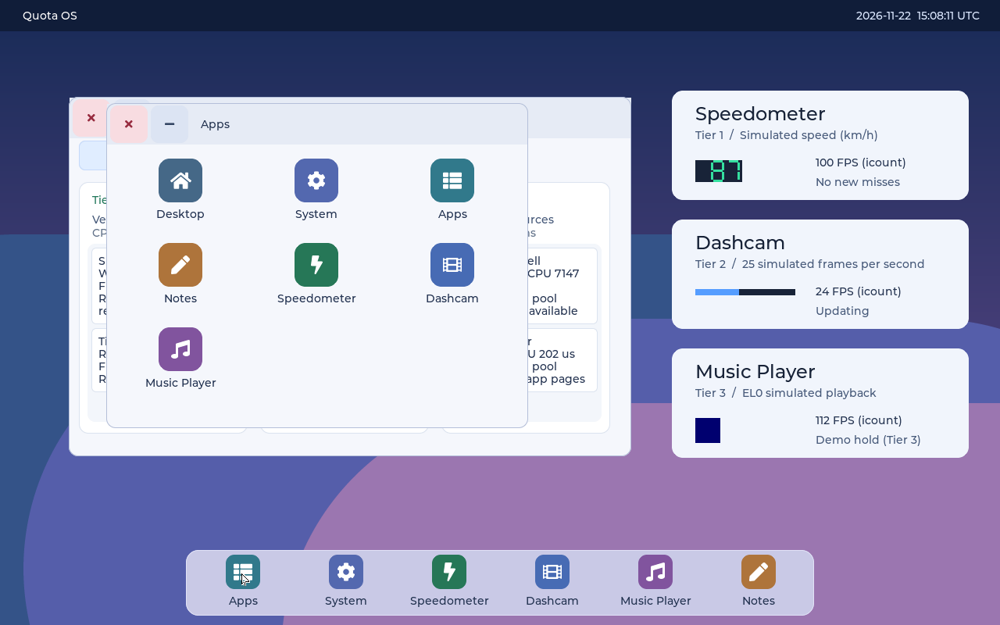
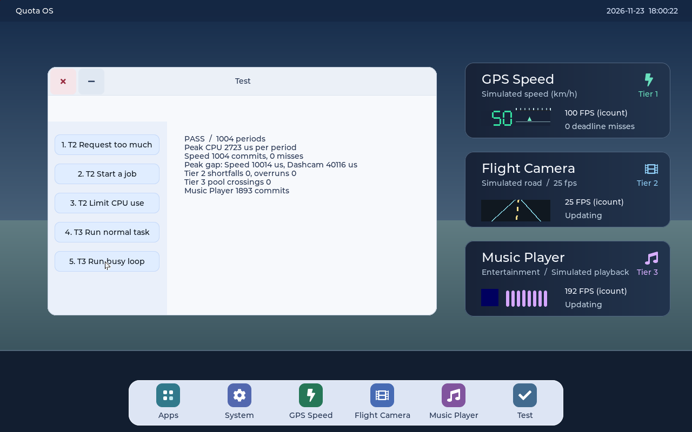
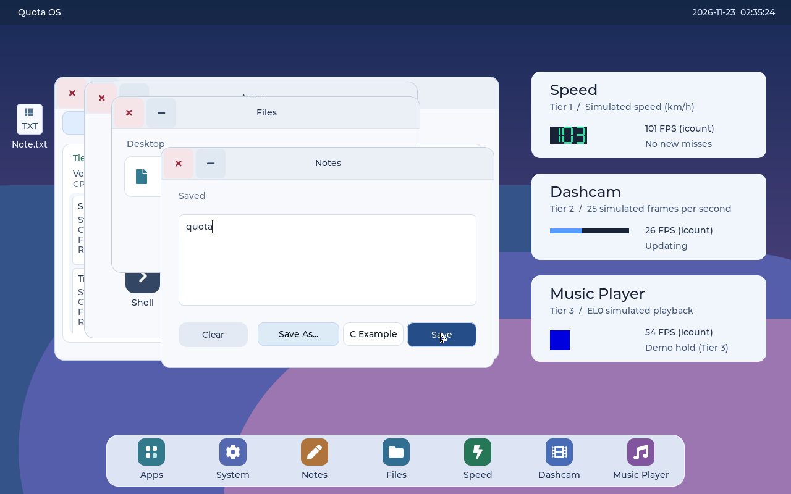
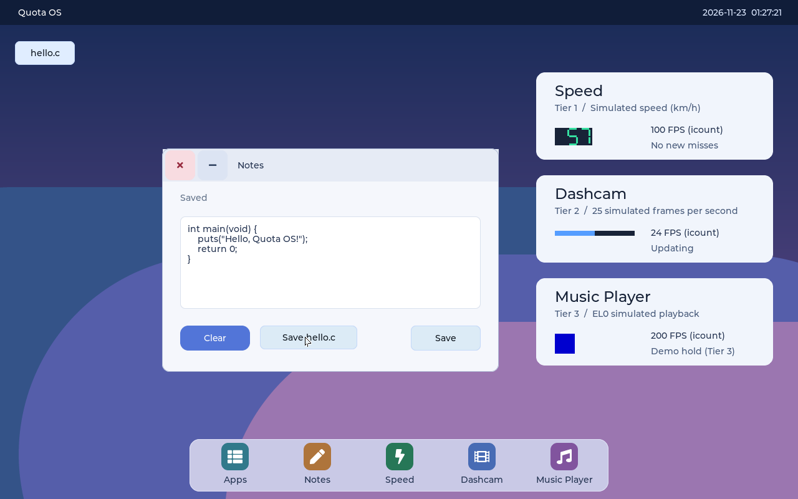
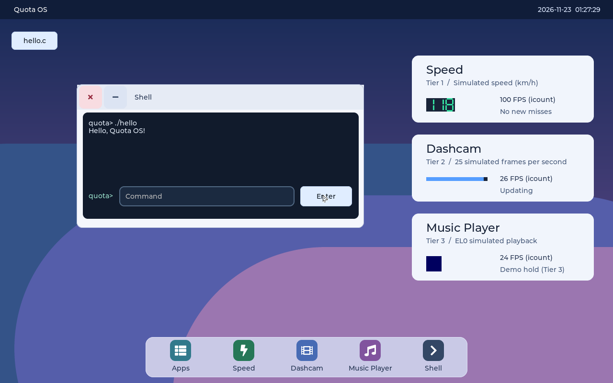

# Quota OS

Quota OS is an experimental single-core ARM64 operating system built around resource quotas. Its 1280 × 800 LVGL desktop runs on QEMU with one Cortex-A35 core and 64 MiB of RAM by default. A speedometer uses a fixed Tier 1 CPU slot, a dashcam demo requests a Tier 2 reservation, and music and desktop interaction share the Tier 3 pool. CPU deadlines are measured against the guest clock. The demos use simulated speed, video frames and playback activity.

Quota OS 是一个以资源配额为核心的单核 ARM64 实验操作系统。一级由厂商预留固定时间槽，二级由应用申报、用户选择启用，三级共享剩余资源。桌面提供任务监控、现场测试和持久笔记，默认以 QEMU 单核 Cortex-A35 和 64 MiB 内存运行。当前验收基于 QEMU 虚拟时钟及帧缓冲提交，物理显示和实际 SSD 的最坏时延尚待验证。

## Tasks and application control

System groups scheduler tasks by tier. Each row shows CPU use in the sampled 10 ms period and the applicable reservation, grant or shared pool. Right-click or long-press a demo task to inspect its controls. The kernel protects Tier 1 tasks. Stopping the dashcam or music player releases its reservations, and restarting it goes through admission again.


## System information

System Info shows the boot peaks for total busy time, kernel time, and Tier 1 job start lateness. It also shows the kernel reserve target, the funded reserve, warning and overrun periods, and CPU returned by completed Tier 2 jobs. CPU values cover the last completed period. The memory percentage measures reserved capacity. The event counters include Tier 2 budget overruns and Tier 3 pool crossings.


## CPU admission and overload

Each 10 ms period starts with four fixed Tier 1 slots totalling 1,500 µs and 80 µs of slot guards. The kernel reserve starts at 350 µs. After a new per-period kernel accounting record, the target grows to 120% of that record rounded up to a whole microsecond. It persists for this boot. At replenishment, growth draws from the Tier 3 pool and respects existing Tier 2 minimum grants. If the pool reaches zero before the target is funded, new positive CPU reservations wait for capacity and their launch requests are refused. System Info displays the gap. [Admission boundary test](docs/tests/adaptive-reserve/boundary.txt)

At a scheduling decision after recorded kernel use reaches 80% of the funded reserve, the scheduler suspends new Tier 3 dispatches for the rest of that period. Tier 1 slots and admitted Tier 2 work retain precedence. A Tier 2 periodic job completing early can return the unused part of its funded minimum for this period when the kernel target is funded. Pending I/O and a voluntary yield from an ordinary thread do not release reserved capacity. The observed peak includes guard handling. Adaptive sizing takes effect in subsequent periods and supplies an empirical margin for these workloads.

In the desktop-stall run the boot peak was 8,354 µs busy per period (83.54%). The kernel peaked at 422 µs as displayed, and the funded reserve reached 507 µs. Tier 1 start lateness rounded up to 1 µs. The last sampled period returned 504 µs to Tier 3. The 100-period window recorded 100 speedometer commits, 25 dashcam commits, zero missed speedometer deadlines and zero pool crossings. The previous image produced the same commit counts and maximum gap of 10,013 µs. These measurements establish isolation in this scenario. An optimal-throughput claim would require comparable useful work per period across workloads. [Before](docs/tests/adaptive-reserve/baseline.log) · [After](docs/tests/adaptive-reserve/stall.log)

The desktop uses QEMU ramfb and measures guest framebuffer commits. A boot with virtio-gpu alone reached the kernel but failed framebuffer initialization. GPU queue timing, host presentation and physical scanout remain unverified. [Virtual GPU probe](docs/tests/adaptive-reserve/virtio-gpu.log)

## Live system checks

Open **System → Test** on the vehicle desktop. Select one workload at a time. The two admissible Tier 2 workloads require **Allow launch**. Cancel dismisses the request before it reserves resources.

| Scenario | What the guest checks |
| --- | --- |
| T2 Oversized request | Request 10,000 µs of CPU per 10 ms period. Admission must refuse the launch. |
| T2 Approved launch | Reserve 400 µs per period and 16 KiB. Verify the periodic job runs and meets its deadline. |
| T2 CPU saturation | Run a CPU-bound task with a 400 µs minimum and an 800 µs ceiling per period. Check shortfalls, overruns and measured peak use. |
| T3 Normal task | Launch an EL0 process that yields voluntarily. Verify it receives CPU time. |
| T3 Infinite loop | Launch an EL0 process that never yields. Observe speedometer commits, deadline misses and shared-pool crossings while it runs. |

The four runnable workloads are sampled for at least 100 guest periods and then stopped. In the captured infinite-loop run the guest reported 109 speedometer commits in 109 periods, zero deadline misses and zero pool crossings. The saturated Tier 2 task peaked at 799 µs over 108 periods with zero recorded shortfalls or overruns. These observations cover this QEMU configuration. Fixed budgets under saturation, resource pressure, physical display latency and hardware timing require separate testing. [Serial log](docs/tests/adaptive-reserve/ui.log)



## Files

Apps stays first in the Dock. Open windows and running vehicle apps occupy the other slots. Minimized windows keep their icon and dot. When all other apps close, up to five recent apps from this desktop session appear in most-recently-used order.

Open **Apps → Files** to browse the dedicated note volume. Each file row displays the name, type and byte count. Selecting the row opens the document in Notes. This first version supports one UTF-8 document of up to 495 bytes.


## Persistent notes

Choose **Save** in Notes and wait for **Saved** before shutting down. Two alternating disk records protect the previous version during an update. The guest reports success after the block device acknowledges the flush. Starting with the same disk restores the saved file.



## Run

With QEMU for ARM64 installed, run this command from the repository root.

```sh
bash tools/run-files.sh
```

The launcher uses the prebuilt kernel and creates a dedicated image at `~/.local/share/quota-os/notes.raw` by default. Set `QUOTA_NOTES_DISK` to choose another dedicated image. The status bar displays Shanghai local time.

## Develop a C application in Quota OS

Start with the Notes disk attached using `bash tools/run-files.sh`. Enter this program in Notes and click **Save hello.c**.

```c
int main(void) {
    puts("Hello, Quota OS!");
    return 0;
}
```

Open **Apps → Shell**. Submit each command with **Enter**.

```sh
cc hello.c -o hello
./hello
```

The compiler emits ARM64 instructions inside Quota OS. The program runs in Tier 3 EL0 and writes `Hello, Quota OS!` to Shell. This first release accepts the small C subset shown above. It supports one saved source file, at most 495 bytes, alongside the existing note. The compiled binary stays in memory until reboot. Tier 2 admission from Shell and a general C compiler remain future work. Tier 1 is vendor reserved. [QEMU serial log](docs/tests/c-workflow/qemu.log)

| Source saved in Notes | Compilation in Shell | Output from EL0 |
| --- | --- | --- |
|  |  |  |

## Verification

The default single-core Cortex-A35 / 64 MiB image passed 100 QEMU `icount` cold boots with the Tier 3 desktop in a busy loop. In every 100-period sample, the guest recorded 100 speedometer commits and 25 dashcam commits, with zero speedometer deadline misses and zero Tier 3 pool crossings. The maximum speedometer commit gap was 10,013 microseconds in each run. This measures guest framebuffer commits. Host presentation and physical scanout remain unverified. [All 100 serial logs and results](docs/tests/cortex-a35/frame-regression.tar.gz)

The default Cortex-A35 / 64 MiB guest passed three desktop-stall boots and three ordinary boots in each demo mode. The five System Test scenarios passed through tablet input. Notes saved on the throttled disk and reopened through Files after a cold boot. In the third desktop-stall run, the speedometer committed 100 frames and the dashcam committed 25 over 100 periods, with zero speedometer deadline misses and zero Tier 3 pool crossings. The QEMU CPU model and RAM changed while the virtual instruction budget remained at `icount shift=4`. [Desktop stall](docs/tests/cortex-a35/03-apps-desktop-stall.log) · [System tests](docs/tests/cortex-a35/ui.log) · [Files](docs/tests/cortex-a35/files.log)

The earlier Cortex-A72 / 128 MiB release passed 100 desktop-stall boots, 100 lifecycle boots, and 10 boots each with and without the dashcam. The tablet-input replay verified all five scenarios and cancellation before approval. With disk writes limited to 128 B/s, the two measured saves took 16.321 and 16.083 seconds of guest time. The speedometer recorded zero deadline misses and Files reopened the saved note after a cold boot. [Cold boot logs](docs/tests/adaptive-reserve/cold-boots.tar.gz) · [Approval replay](docs/tests/adaptive-reserve/ui.log) · [Save](docs/tests/adaptive-reserve/save.log) · [Reopen](docs/tests/adaptive-reserve/reopen.log)

In the earlier live-checks regression, 100 lifecycle cold boots and 100 desktop-stall cold boots passed under QEMU TCG with `-icount shift=4,sleep=off`. The two ordinary application modes passed 10 cold boots each. In the separate 128 B/s disk test, two sustained saves took 14.315 s and 13.211 s of guest time. The speedometer committed 1,431 and 1,321 frames respectively, with zero deadline misses. A fresh guest reopened the note through Files and the test compared the bytes. [First boot](docs/tests/optimization/live-checks/save.log) · [Second boot](docs/tests/optimization/live-checks/reopen.log) · [Live checks](docs/tests/optimization/live-checks/ui.log) · [Regression logs](docs/tests/optimization/live-checks/regressions.tar.gz)

The LVGL desktop is the working implementation on `main` and `Desktop-LVGL-120X800`. The `Desktop-Webkit-120X800` branch starts from the same revision for WebKit desktop development. Earlier design notes, build instructions and historical experiments are in the [technical notes](TECHNICAL-NOTES.md). [Apache 2.0 license](LICENSE)
